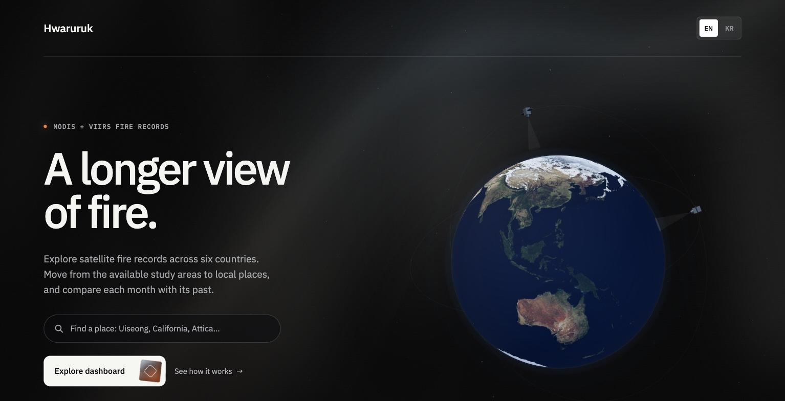
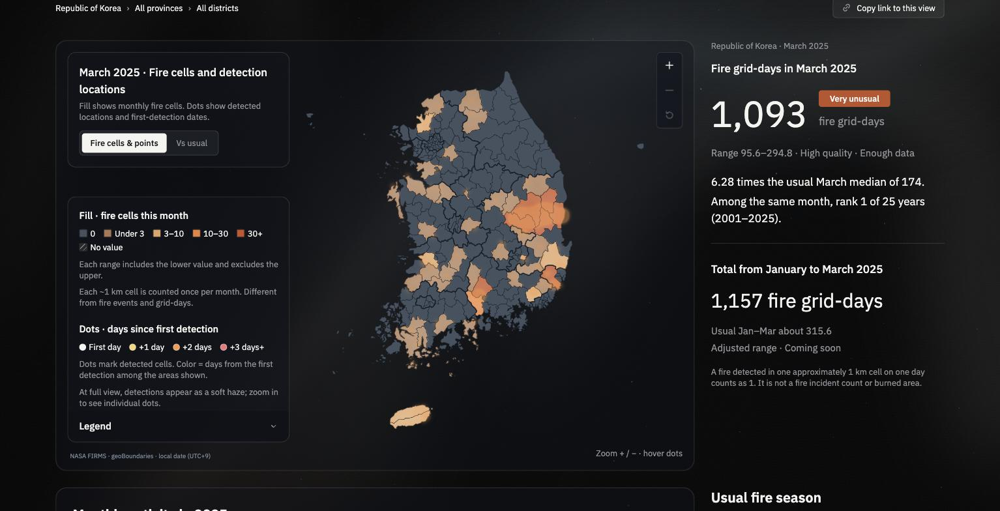
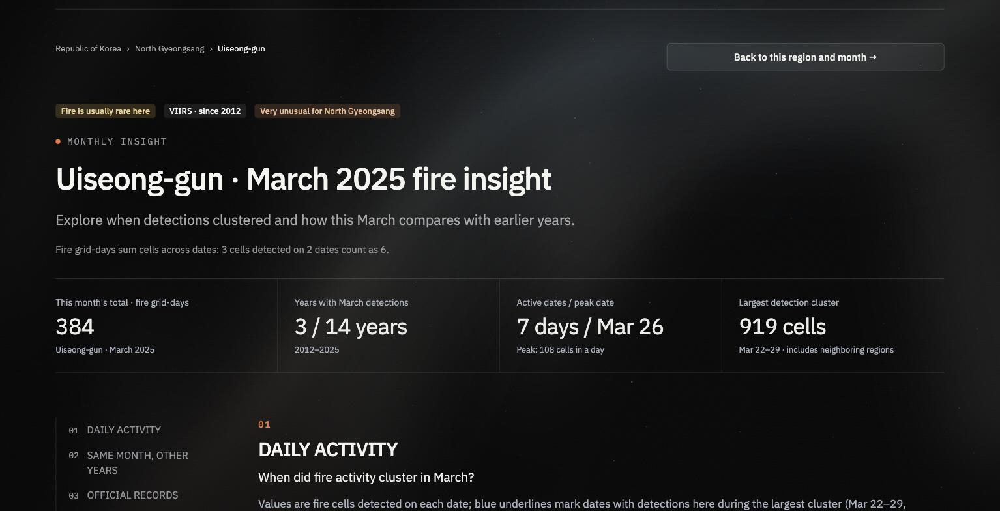

# Hwaruruk — 프론트엔드

### 🔗 배포 주소: https://hwaruruk.unzipp.cloud

[대시보드](https://hwaruruk.unzipp.cloud/dashboard/KOR?month=2025-03) · [월간 인사이트](https://hwaruruk.unzipp.cloud/insight/KOR/91817680B75376031789242?month=2025-03) · [기법](https://hwaruruk.unzipp.cloud/method)

[English](./README.md)

위성이 감지한 화재 기록을 지역과 달별로 보여 주는 웹 앱입니다. 어느 달이든 지난 해들의 같은 달과 비교할 수 있습니다. 이 저장소는 웹 프론트엔드이며, NASA Space Apps Challenge 2026(서울) 출품작입니다.

[](https://hwaruruk.unzipp.cloud)

## 무엇을 보여 주나

MODIS와 VIIRS의 화재 감지 기록을 하나의 이어진 기록(2001년부터)으로 맞추고 **화재 감지일**로 셉니다. 약 1 km 칸에서 하루 동안 불이 감지되면 1입니다. 과거 화재 활동의 기록이며, 화재 건수나 피해 면적이 아니고 실시간 경보도 아닙니다.

지역: 한국, 캘리포니아, 브리티시컬럼비아, 뉴사우스웨일스, 그리스, 칠레.

| 화면 | 주소 | 내용 |
| --- | --- | --- |
| 첫 화면 | `/` | 지역 검색, 지역의 한 해 흐름, 기록이 말해 주는 것과 한계 |
| 기법 | `/method` | 위성 기록을 맞추고 검증한 방법 |
| 대시보드 | `/dashboard/:country[/:regionId]` | 지도, 이번 달과 평소 비교, 연도별·월별 달력, CSV·PNG 내려받기 |
| 월간 인사이트 | `/insight/:country/:regionId` | 시·군·구 하나의 한 달: 일별 활동, 다른 해, 공식 기록, 주변 지역 |

한국어는 `/…`, 영어는 `/en/…`입니다. 기준 월은 `?month=YYYY-MM`. 나라 코드: `KOR`, `CAL`, `BC`, `NSW`, `GRC`, `CHL`.

### 화면에서 쓰는 말

| 말 | 뜻 |
| --- | --- |
| 화재 감지일 | 약 1 km 칸에서 하루 동안 불이 감지된 것 하나. 앱의 모든 숫자가 이 단위입니다 |
| 평소 범위 | 같은 달이 보통 해에 놓였던 범위(지난 해들의 15~85% 구간에 작은 수 보정을 더한 것) |
| 평가 칩 | 이번 달을 평소 범위와 비교한 결과: 매우 이례적, 평소보다 많음, 평소 범위, 평소보다 적음 |
| 보정 후 / 보정 전 | 보정 후는 모든 위성을 NOAA-20 기준으로 맞춘 값이라 해끼리 비교할 수 있습니다. 보정 전은 각 위성이 기록한 그대로입니다 |
| 평소 불이 드문 지역 | 감지가 적어 자기 기록만으로는 평가할 수 없는 시·군·구. 상위 지역의 평가를 빌려 쓰고, 화면에 그 사실을 밝힙니다 |

| 대시보드 | 월간 인사이트 |
| --- | --- |
|  |  |

## 기술

| 기술 | 맡은 일 | 이 프로젝트에서 쓴 이유 |
| --- | --- | --- |
| React 19 + TypeScript | 모든 화면과 컴포넌트 | `any` 없이 엄격한 타입. API 응답 타입을 클라이언트·훅·목 데이터가 함께 써서, 어긋나면 타입 검사에서 걸립니다 |
| Vite | 개발 서버와 배포 빌드 | 빠르게 뜨고, 환경 변수(`VITE_API_MODE`)로 코드 수정 없이 목 데이터와 실제 서버를 바꿉니다 |
| React Router | 주소 구조: `/`와 `/en` 두 벌, 나라·지역은 경로, 달은 쿼리 | 선택이 주소에 있어 링크 공유와 뒤로·앞으로 가기가 그대로 됩니다. 화면 전환(슬라이드, 언어 전환 페이드)도 여기서 겁니다 |
| TanStack Query | 서버 데이터: 캐시, 재시도, 로딩·에러 상태 | 기준 자료(`/meta`, `/regions`)는 한 번 받아 여러 화면이 같이 씁니다. 실패하면 한 번 다시 시도한 뒤 에러와 다시 시도 버튼을 보입니다 |
| Tailwind CSS 4 | 배치와 스타일 | 색·간격·글자 크기 토큰을 스타일시트 한 곳에 두고 유틸리티 클래스로 씁니다 |
| MapLibre GL | 대시보드와 인사이트의 지역 지도 | 배경 지도 없이 API가 준 경계와 감지 점을 그리고, 확대와 올려 보기를 지원합니다 |
| ECharts | 대시보드의 월별 선 그래프 | 평소 범위 띠와 툴팁이 있는 선 그래프. 달력 히트맵과 막대 그래프는 DOM과 SVG로 직접 그려 키보드로도 다룰 수 있습니다 |
| three.js | 첫 화면의 도는 지구 | 따로 받아 오게 해서 첫 화면이 뜨는 것을 늦추지 않습니다 |
| Vitest + Testing Library | 단위·화면 테스트(560개) | 테스트는 목 데이터로 돌고 실제 API를 부르지 않습니다 |
| ESLint (typescript-eslint) | 정적 검사 | 타입 검사·테스트와 함께 커밋 전에 돌립니다 |

## 실행 방법

Node.js 22 이상이 필요합니다. 개발 서버는 목 데이터로 뜨기 때문에 API 없이도 돌아갑니다. 실제 API를 부르려면 `VITE_API_MODE=live`를 줍니다.

```bash
npm install
npm run dev                       # 목 데이터, http://localhost:5173
VITE_API_MODE=live npm run dev    # 실제 API
npm run build                     # 타입 검사 후 dist/에 빌드
npm run typecheck && npm run lint && npm run test
```

| 변수 | 값 | 기본값 |
| --- | --- | --- |
| `VITE_API_MODE` | `mock` · `live` | 개발 서버는 `mock`, 배포 빌드는 `live` |
| `VITE_API_BASE` | `/api/v1`로 끝나는 API 주소 | 개발 서버는 `https://burnline-api.unzipp.cloud/api/v1`, 배포 빌드는 `/api/v1`(같은 출처) |

목 데이터는 `src/api/mock/`에 있고 API와 같은 응답 타입을 따릅니다. CSV 내려받기는 파일이 서버에서 오기 때문에 목 모드에서는 막혀 있습니다.

## 폴더 구조

자료는 한 방향으로 흐릅니다: `api` → `hooks` → `pages` → `components`. 페이지가 주소를 읽고 훅을 부르며, 컴포넌트는 값을 props로 받을 뿐 직접 요청하거나 주소를 읽지 않습니다.

```
src/
  api/          HTTP 클라이언트, 엔드포인트 함수, 응답 타입, 목 데이터
  hooks/        데이터 훅(TanStack Query), 엔드포인트마다 하나
  lib/          순수 함수: 표기, 달·지역 계산, 그래프·지도용 자료
  components/   다시 쓰는 UI: 카드, 대화상자, 히트맵, 지도, 그래프
  pages/        화면마다 폴더 하나, 구역별 파일
  i18n/         한국어·영어 문구
  app/          라우터, 레이아웃, 페이지 전환
```

## 설계에서 정한 것

- **값의 기준은 API입니다.** 감지일, 평소 범위, 순위, 판정은 API가 준 값입니다. 프론트엔드는 표기와 그리기만 하고 다시 계산하지 않습니다.
- **선택의 기준은 주소입니다.** 나라와 지역은 경로에, 달은 쿼리에 두어 어느 화면이든 링크로 공유할 수 있습니다.
- **목 데이터와 실제 서버를 한 곳에서 가릅니다.** `src/api/client.ts`만 둘을 구분하므로 훅과 화면은 두 모드에서 같습니다.
- **실패는 반드시 화면에 보입니다.** 실패한 요청은 그 자료를 쓰는 구역 안에 문구와 다시 시도 버튼으로 나옵니다. 컴포넌트에서 직접 `fetch`하지 않습니다.
- **지역은 자료로만 달라집니다.** 단일 단계 지역(캘리포니아, BC, NSW)과 두 단계 지역(한국, 그리스, 칠레)이 같은 화면을 쓰고, 칸 이름과 지도 구간은 API에서 옵니다.

## 트러블슈팅 기록

프론트엔드를 만들면서 겪은 문제와 찾은 원인, 적용한 해결입니다.

| 문제 | 원인 | 해결 |
| --- | --- | --- |
| 내려받은 CSV를 Excel에서 열면 한글이 깨짐 | `res.text()`가 서버가 붙인 UTF-8 BOM을 떼어 냄 | 파일을 `Blob`으로 받아 바이트 그대로 저장 |
| 일부 실패한 응답이 다시 시도해도 계속 돌아옴 | 실패한 응답의 `ETag`가 정상 응답과 같아 브라우저가 깨진 본문을 다시 씀 | 다시 시도는 `cache: "reload"`로 요청. 인사이트 요청은 항상 이 방식 |
| 지도에서 시·도 경계가 시·군·구 도형과 어긋남 | 시·도와 시·군·구 경계의 원본 정밀도가 다름(최대 20 km 차이) | 시·도 경계를 시·군·구 도형에서 만들어 그림 |
| `/method#harmonize`가 한 언어에서 동작하지 않음 | 절 ID가 한국어와 영어 페이지에서 달랐음 | 두 언어가 같은 절 ID를 씀 |
| 다른 지역으로 옮기면 화면이 맨 위로 천천히 굴러감 | 문서 전체에 부드러운 스크롤을 켰음 | 기법 페이지에서만 켜고, 인사이트는 목차 항목을 누를 때만 부드럽게 이동 |
| 숫자 올라가기가 시작할 때 음수가 잠깐 보임 | `requestAnimationFrame`의 프레임 시각이 `performance.now()`로 잡은 시작 시각보다 앞설 수 있음 | 진행률을 0~1로 자름 |
| 영어 화면에 한글이 나옴 | API가 일부 이름(공식 기록 출처·원인)을 한글로만 줌 | 아는 값은 번역표로 바꾸고 모르는 값은 받은 그대로 표시 |

## 데이터와 API

프론트엔드는 읽기만 합니다. 모든 엔드포인트는 `/api/v1/{나라}` 아래의 `GET`입니다.

| 엔드포인트 | 쓰는 곳 |
| --- | --- |
| `/meta`, `/regions`, `/geo` | 지역 단계 이름, 지도 구간, 자료 기준일, 지역 목록과 경계 |
| `/series/{id}`, `/baseline/{id}` | 달력과 그래프의 월별 값, 달마다의 평소 범위 |
| `/judgement/{id}` | 이번 달 숫자 카드: 값, 평가 칩, 순위, 누적 |
| `/map`, `/top` | 지도 색과 감지 점, 두드러진 곳·인접 지역 목록 |
| `/insight/{id}` | 월간 인사이트 화면의 모든 내용을 한 번에 |
| `/landing` | 첫 화면과 기법 페이지의 그림 |
| `/export.csv` | CSV 내려받기 |

- API: `https://burnline-api.unzipp.cloud/api/v1` · [백엔드](https://github.com/NasaSpaceAppsSeoul/NasaSpaceAppsSeoul_backend) · [데이터 파이프라인](https://github.com/NasaSpaceAppsSeoul/NasaSpaceAppsSeoul_data)
- 위성 기록: NASA FIRMS (MODIS C6.1, VIIRS C2: S-NPP, NOAA-20, NOAA-21)
- 검증에 쓴 공식 산불 기록: 산림청, CAL FIRE, BC Wildfire Service, NSW NPWS, 그리스 소방청, CONAF
- 경계: geoBoundaries, BC Data Catalogue

## 배포

Vercel에 배포합니다(주소는 이 문서 맨 위). `main`에 병합하면 자동으로 배포되고, PR에는 미리보기 주소가 붙습니다. `vercel.json`이 `/api/*` 요청을 API 서버로 넘기므로 브라우저는 한 주소만 상대하고 CORS 설정이 필요 없습니다. API 응답은 Vercel CDN에 저장하지 않습니다.

## 만든 사람

**손영빈(YeongBin Son)** — iOS 개발자, 이 프로젝트에서 웹 프론트엔드를 맡았습니다.
