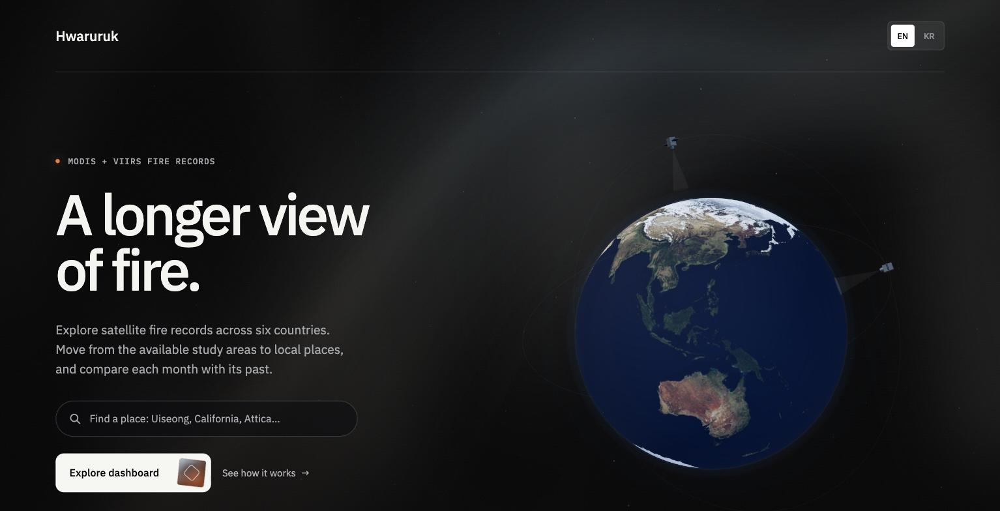
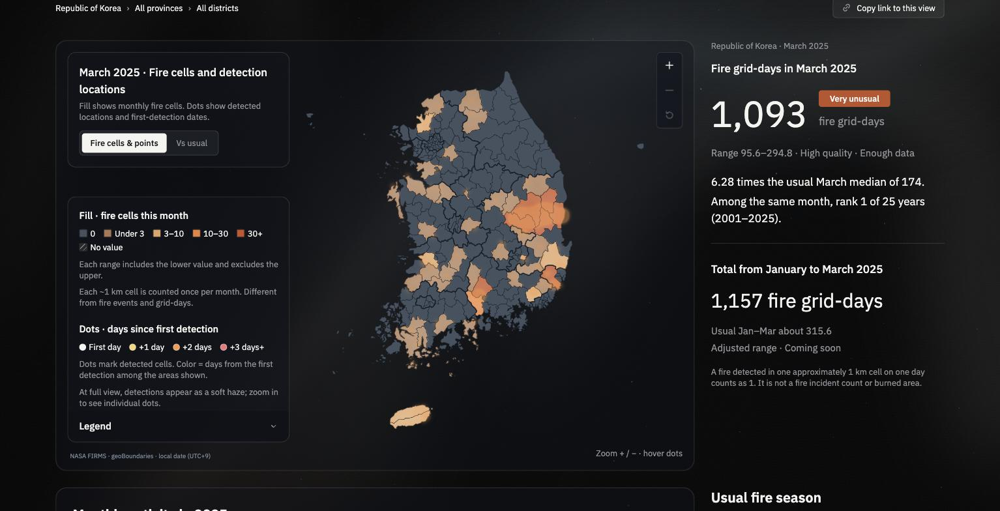
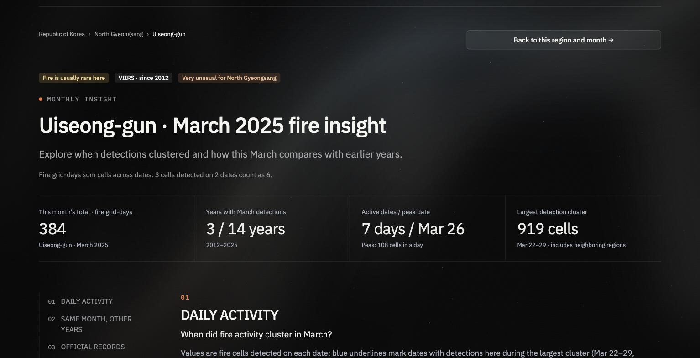

# Hwaruruk — Frontend

### 🔗 Live demo: https://hwaruruk.unzipp.cloud

[Dashboard](https://hwaruruk.unzipp.cloud/en/dashboard/KOR?month=2025-03) · [Monthly insight](https://hwaruruk.unzipp.cloud/en/insight/KOR/91817680B75376031789242?month=2025-03) · [Method](https://hwaruruk.unzipp.cloud/en/method)

[한국어](./README.ko.md)

A web app that shows satellite fire-detection records by region and month, so any month can be compared with the same month in earlier years. This repository is the web frontend, built for NASA Space Apps Challenge 2026 (Seoul).

[](https://hwaruruk.unzipp.cloud)

## What it shows

MODIS and VIIRS active-fire records are joined into one continuous series (2001 onward) and counted as **fire grid-days**: one ~1 km cell with fire detected on one day counts as 1. It is a record of past fire activity, not a count of fire incidents, not burned area, and not a real-time alert.

Regions: South Korea, California, British Columbia, New South Wales, Greece, Chile.

| Screen | Path | Contents |
| --- | --- | --- |
| Home | `/` | Place search, a region's year at a glance, what the records can and cannot tell |
| Method | `/method` | How the satellites are harmonized and validated |
| Dashboard | `/dashboard/:country[/:regionId]` | Map, this month against usual, year-by-month calendar, CSV and PNG export |
| Monthly insight | `/insight/:country/:regionId` | One district and one month: daily activity, other years, official records, neighbors |

Korean is served at `/…`, English at `/en/…`. The reference month is `?month=YYYY-MM`. Country codes: `KOR`, `CAL`, `BC`, `NSW`, `GRC`, `CHL`.

### Terms used on screen

| Term | Meaning |
| --- | --- |
| Fire grid-day | One ~1 km cell with fire detected on one day. The unit of every number in the app |
| Usual range | Where the same month fell in ordinary years (15th–85th percentile of past years, with a small-count allowance) |
| Judgment chip | This month against the usual range: very unusual, above usual, usual range, below usual |
| Harmonized / raw | Harmonized values put every satellite on the NOAA-20 scale so years can be compared. Raw values are what each satellite recorded |
| Sparse area | A district with too few detections to judge on its own. Its judgment borrows the parent region's, and the screen says so |

| Dashboard | Monthly insight |
| --- | --- |
|  |  |

## Tech stack

| Tool | Used for | Why here |
| --- | --- | --- |
| React 19 + TypeScript | All screens and components | Strict types with no `any`: API response types are shared by the client, hooks and mock data, so a mismatch fails at type-check |
| Vite | Development server and production build | Fast start, and environment variables (`VITE_API_MODE`) switch mock and live data without code changes |
| React Router | Routing: `/` and `/en` trees, country and region in the path, month in the query | The URL holds the selection, so links and browser back/forward work. View transitions give the page slide and language fade |
| TanStack Query | Server data: caching, retry, loading and error states | Reference data (`/meta`, `/regions`) is fetched once and reused across screens. Failed requests retry once, then show an error with a retry button |
| Tailwind CSS 4 | Layout and styling | Design tokens (colors, spacing, type) live in one stylesheet and are used as utility classes |
| MapLibre GL | Region maps on the dashboard and insight screens | Draws boundaries and detection points from the API without a base map, with zoom and hover |
| ECharts | Monthly line chart on the dashboard | Line with a usual-range band and tooltips. The calendar heatmap and bar charts are plain DOM and SVG, which keeps them accessible by keyboard |
| three.js | Rotating Earth on the home screen | Loaded separately so it does not delay the first paint |
| Vitest + Testing Library | Unit and screen tests (560 tests) | Tests run on mock data and never call the real API |
| ESLint (typescript-eslint) | Static checks | Run together with type-check and tests before every commit |

## Getting started

Requires Node.js 22 or later. The development server starts on mock data, so it runs without the API. Set `VITE_API_MODE=live` to call the real API.

```bash
npm install
npm run dev                       # mock data, http://localhost:5173
VITE_API_MODE=live npm run dev    # real API
npm run build                     # type-check and build into dist/
npm run typecheck && npm run lint && npm run test
```

| Variable | Values | Default |
| --- | --- | --- |
| `VITE_API_MODE` | `mock` · `live` | `mock` in development, `live` in a production build |
| `VITE_API_BASE` | API base URL ending in `/api/v1` | `https://burnline-api.unzipp.cloud/api/v1` in development, `/api/v1` (same origin) in a production build |

Mock data lives in `src/api/mock/` and follows the same response types as the API. CSV export is disabled in mock mode because the file comes from the server.

## Project structure

Data flows one way: `api` → `hooks` → `pages` → `components`. Pages read the URL and call hooks; components receive values as props and do not fetch or read the URL themselves.

```
src/
  api/          HTTP client, endpoint functions, response types, mock data
  hooks/        Data hooks (TanStack Query), one per endpoint
  lib/          Pure functions: formatting, month and region logic, chart and map data
  components/   Reusable UI: cards, dialogs, heatmap, map, charts
  pages/        One folder per screen, split into sections
  i18n/         Korean and English copy
  app/          Router, layout, page transitions
```

## Design decisions

- **The API is the source of truth for values.** Counts, usual ranges, ranks and judgment labels come from the API. The frontend formats and draws them and does not recompute.
- **The URL is the source of truth for selection.** Country and region are in the path and the month is in the query, so every view can be shared as a link.
- **One client for mock and live.** `src/api/client.ts` is the only place that decides between bundled mock data and the real API, so hooks and screens are identical in both modes.
- **Every failure is visible.** A failed request shows a message and a retry button inside the section that needed it. Components never call `fetch` directly.
- **Regions differ only by data.** Single-level regions (California, BC, NSW) and two-level ones (Korea, Greece, Chile) use the same screens; labels and map breaks come from the API.

## Troubleshooting notes

Problems met while building the frontend, with the cause found and the fix applied.

| Problem | Cause | Fix |
| --- | --- | --- |
| Korean text broke when the exported CSV was opened in Excel | `res.text()` strips the UTF-8 BOM the server sends | Download the file as a `Blob` and save the bytes as they are |
| A partly failed response kept coming back after retry | The failed response had the same `ETag` as a good one, so the browser revalidated and reused the broken body | Retry with `cache: "reload"`; the insight request always uses it |
| Province borders did not line up with district shapes on the map | Province and district boundaries came from sources of different detail (up to 20 km apart) | Build province borders from the district shapes |
| `/method#harmonize` did not work in one language | Section IDs differed between the Korean and English pages | Use the same section IDs in both languages |
| Moving to another region scrolled slowly back to the top | Smooth scrolling was enabled for the whole document | Enable it only on the method page; on the insight page scroll smoothly only when a table-of-contents item is clicked |
| Numbers flashed negative at the start of the count-up animation | The frame time from `requestAnimationFrame` can be earlier than the start time taken with `performance.now()` | Clamp the progress to 0–1 |
| Korean text appeared on English screens | The API returns some names only in Korean (official record sources and causes) | Translate known values with a lookup table and show unknown values as received |

## Data and API

The frontend only reads. All endpoints are `GET` under `/api/v1/{country}`.

| Endpoint | Used for |
| --- | --- |
| `/meta`, `/regions`, `/geo` | Region labels, map breaks, data end date, region list and boundaries |
| `/series/{id}`, `/baseline/{id}` | Monthly values for the calendar and charts, usual range per month |
| `/judgement/{id}` | This month's number card: value, chip, rank, year-to-date total |
| `/map`, `/top` | Map fill and detection points, standout or neighboring regions |
| `/insight/{id}` | Everything on the monthly insight screen in one response |
| `/landing` | Figures on the home and method screens |
| `/export.csv` | CSV download |

- API: `https://burnline-api.unzipp.cloud/api/v1` · [backend](https://github.com/NasaSpaceAppsSeoul/NasaSpaceAppsSeoul_backend) · [data pipeline](https://github.com/NasaSpaceAppsSeoul/NasaSpaceAppsSeoul_data)
- Satellite records: NASA FIRMS (MODIS C6.1, VIIRS C2: S-NPP, NOAA-20, NOAA-21)
- Official fire records for validation: Korea Forest Service, CAL FIRE, BC Wildfire Service, NSW NPWS, Hellenic Fire Service, CONAF
- Boundaries: geoBoundaries, BC Data Catalogue

## Deployment

Deployed on Vercel at the address at the top of this page. Every merge into `main` is deployed automatically, and pull requests get a preview URL. `vercel.json` forwards `/api/*` to the API server, so the browser only talks to one origin and no CORS setup is needed. API responses are not cached on the Vercel CDN.

## Author

**YeongBin Son (손영빈)** — iOS developer, in charge of the web frontend for this project.
